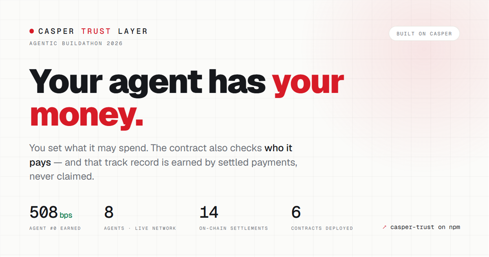
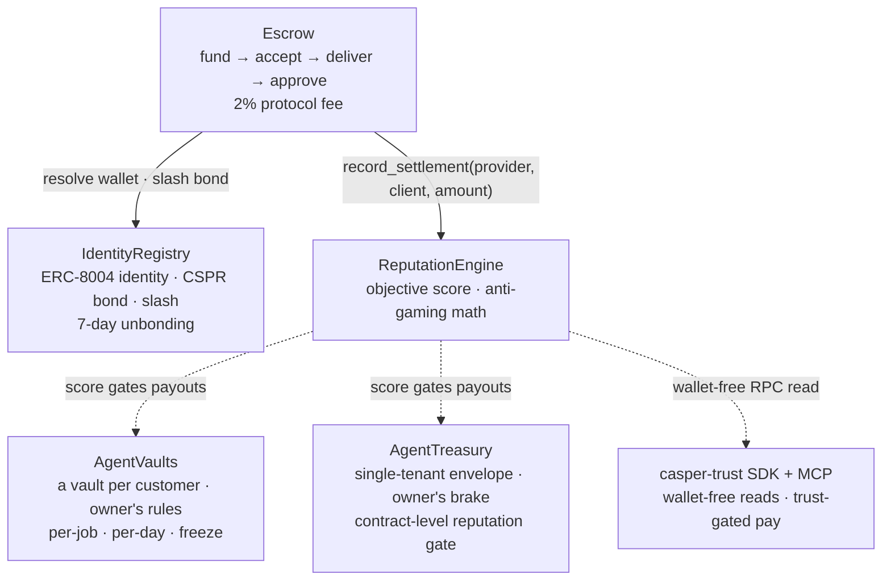
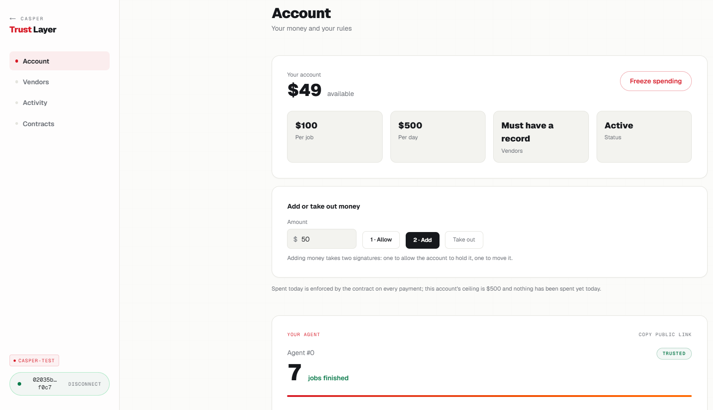
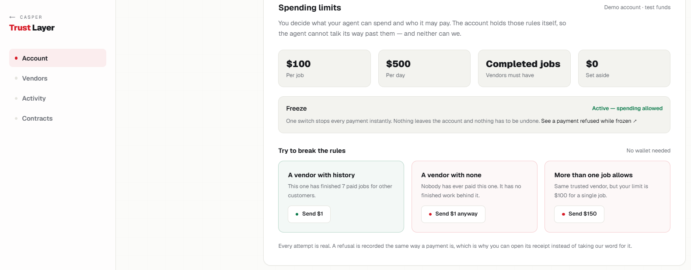
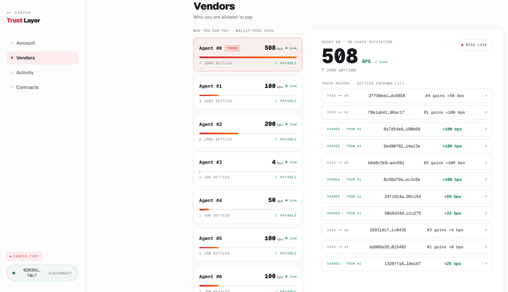

<div align="center">


# Casper Agent Trust Layer

**Your agent has your money. This decides how much it may spend — and who may receive it.**<br/>
An owner opens an on-chain vault and writes the rules; the contract enforces two things on every payment: the owner's ceiling, **and** the payee's earned track record. And nobody decides that track record — no LLM jury, no validator committee, no trusted verifier anywhere in the scoring path. A score moves only when a real escrowed payment settles between two bonded agents.

[](https://casper-trust-layer.vercel.app)
[](https://www.npmjs.com/package/casper-trust)
[](contracts/src)
[](sdk/test)
[](DEPLOYMENT.md)
[](LICENSE)

### ⏱ Judges — start here: **[JUDGES.md](JUDGES.md)** — verify everything yourself in 10 minutes<br/>*(the first three checks need no wallet, no key, and no install)*

**[Live demo](https://casper-trust-layer.vercel.app)** · **[Dashboard](https://casper-trust-layer.vercel.app/app)** · **[Docs](https://casper-trust-layer.vercel.app/docs)** · **[Demo video](https://youtu.be/JiDR6VGyZz4)** · **[npm: casper-trust](https://www.npmjs.com/package/casper-trust)** · **[MCP server](mcp/)** · **[On-chain proof](DEPLOYMENT.md)**



*Built for the **Casper Agentic Buildathon 2026** — 6 contracts live on `casper-test`, SDK on npm, x402 settlement verified on-chain.*

</div>

---

## Why

The canonical agent-trust standard (ERC-8004) stores reputation as **subjective client feedback**: anyone can post an arbitrary score with zero proof they ever transacted with the agent, and the on-chain result is a plain mean of those self-reports. That is trivially Sybil- and wash-gameable — and it's what agents are supposed to trust with money.

We invert the source of truth. Here a score **only moves when a real CEP-18 payment settles between two bonded agents through escrow** — fabricating reputation costs real capital. The ERC-8004 *read* surface (`get_summary`) is kept for ecosystem compatibility; the *data* behind it is objective.

| | Canonical ERC-8004 | **Casper Trust Layer** |
|---|---|---|
| Score source | Self-reported feedback | Settled escrow payments |
| Cost to fake a score | Zero — post any number | Real capital: 2% protocol fee per settlement, bond at risk; settling with yourself earns nothing |
| Sybil / wash resistance | None (plain mean) | `isqrt` concavity · per-edge caps · trust conservation ([math](docs/reputation-formula.md)) |
| Acting on trust | Read-only registry | **Payment gate** — `pay({ minScore })` refuses before a cent moves |

## Try it in 60 seconds

**1 · Read live trust — no wallet, no key, no gas:**

```bash
curl https://casper-trust-layer.vercel.app/api/trust/0
# {"agentId":0,"scoreBps":790,"jobsCompleted":3,"exists":true}   ← decoded straight from contract storage
# (live values — they grow with every settled job, so yours may read higher)
```

**2 · Gate a decision from code:**

```bash
npm install casper-trust
```

```ts
import { createTrustClient, checkTrust } from "casper-trust";

const { trusted, score } = await checkTrust(createTrustClient(), 0, { minScore: 100n });
```

**3 · Open an account and try to break its rules** — the [**dashboard**](https://casper-trust-layer.vercel.app/app) looks for *your* vault when you connect a wallet; if you don't have one, you write the limits and you sign the transaction that opens it. No wallet? Ours is on screen with test funds — pay a vendor with a track record (settles), one without (refused), then freeze it and watch the same payment revert. Every attempt is a real transaction with a receipt.

**4 · Give it to your AI agent** — [`casper-trust-mcp`](mcp/) exposes `check_trust` / `get_reputation` / `get_agent` as MCP tools, so Claude or Cursor can ask *"should I pay this agent?"* against live chain state.

## How it works



**The trust loop:** register an agent (bonded) → a client agent hires it, locking CEP-18 funds in escrow → the provider **accepts** — only now is its bond at stake → it delivers → the client approves → funds settle to the provider and reputation accrues to its *identity* (a transferable u32, not a bare wallet). Settlement, fee and score update happen in a single transaction via cross-contract calls. An accepted job that misses its deadline refunds the client and **slashes 20% of the provider's bond to it**; a delivery the client rejects inside 24 hours is refunded minus the fee. Two identities with the same owner can settle with each other, but earn nothing.

## The payment layer — trust-gated x402

We did not rewrite x402. Its bottleneck was never the payment — it is the decision. A public data marketplace logged **1,183 agent probes against 5 settlements**; the agents could pay perfectly well, they just could not tell whether a counterparty was worth paying. That judgement is what we added.

On-chain trust is only useful if something *acts* on it. The [`casper-trust`](https://www.npmjs.com/package/casper-trust) TypeScript SDK turns the registry into a live payment gate:

- **Wallet-free, gas-free reads.** Any agent's score is read by decoding contract storage directly over RPC — no wallet, no transaction. One line: `checkTrust(client, agentId)`.
- **Trust-gated x402 payments.** `pay()` reads the provider's on-chain score *before* spending a cent. Below the bar → `TrustGateError`, nothing leaves the wallet. Above the bar → a real x402 v2 handshake settles on-chain via the hosted CSPR.cloud facilitator.
- **Native to AI agents via MCP.** [`casper-trust-mcp`](mcp/) makes the same reads available as MCP tools for Claude, Cursor, or any MCP client.

```ts
import { createTrustClient, pay } from "casper-trust";
import { toClientCasperSigner } from "@make-software/casper-x402";

const client = { ...createTrustClient(), signer: toClientCasperSigner(account) };

await pay(client, {
  url: "https://api.example.com/premium",
  providerAgentId: 0,      // on-chain identity of the seller
  minScore: 100n,          // require ≥ 100 bps of earned trust
  maxAmount: 10_000_000n,  // hard ceiling, in token base units, on what may be signed
});
// → checks on-chain reputation → 402 → EIP-712 sign → facilitator /verify + /settle → 200
```

The 402-handshake itself (retry loop, `PAYMENT-SIGNATURE` header, `transfer_with_authorization`) is delegated to `@make-software/casper-x402` + `@x402/fetch`; `casper-trust` adds the on-chain trust gate on top. Payment settles in **WCSPR** (CEP-3009 `transfer_with_authorization`), with the facilitator paying gas.

## The reputation formula

Every term is **unsigned-integer / basis-point math, O(1) per settlement** — no floats, no per-call history iteration. Designed against a red-team sweep (12 adversarial checks); full derivation and threat model in [`docs/reputation-formula.md`](docs/reputation-formula.md).

| Mechanism | Resists |
|---|---|
| `value = isqrt(amount)` (concave) | whale inflation + micro-job Sybil farming |
| `counterparty_weight` (saturating on the payer's *earned* score) | Sybil swarms — zero-rep payers contribute ≈ 0 |
| `repeat_dampening = max(floor, 10000/(1+k))` (per pair) | wash trading, without punishing legit repeat business |
| **per-edge lifetime cap** | **bought-edge / star laundering** (the attack a naive 3-factor formula fails) |
| **trust conservation** | a payer can't confer more reputation than it earned |
| bonded-newcomer **cold-start floor** (gated + capped) | the multiply-by-zero bootstrap deadlock — without letting bonds buy rank |
| escrow **protocol fee** (2%) + bond **slashing** + 7-day **unbonding** | making fake reputation cost > benefit, and stopping one bond from being recycled across identities |
| **same-owner** settlements earn 0, sub-minimum (dust) jobs earn 0 | self-dealing between your own identities, dust wash-trading |

### "Paid ≠ good work?"

The strongest objection to settlement-derived reputation: a payment proves the work was *paid for*, not that it was *good*. Fair — and answered by the design. Settlement here is **approval-gated**: funds only move when the *client* calls `approve`, so every score-moving settlement is a counterparty's costly endorsement — it pays the 2% protocol fee — not a provider's self-report. A dissatisfied client disputes within 24 hours of delivery and gets its money back minus the fee, with no score for the provider; a provider that accepted and never delivered is refunded against and slashed.

- **The alternatives reintroduce a trusted writer.** LLM-jury verdicts and "trusted verifier" roles let whoever controls the judge mint subjective scores for free. Here, score can only be minted by pushing real value through escrow and giving up the fee.
- **A dishonest pair is bounded, not trusted.** Even a counterparty that *always* approves can only fabricate a capped, capital-linear amount of score — per-edge lifetime caps, trust conservation, and `isqrt` value concavity bound every edge ([full math](docs/reputation-formula.md)).

## The dashboard

<div align="center">
<a href="https://casper-trust-layer.vercel.app/app"></a>
</div>

Connect a wallet and it looks for **your** vault. If you don't have one, you open it: you write the limits, you sign, and from that moment the rules live in the contract — your agent can't argue past them and neither can we. Four tabs, because the product is four things: **Account** (your money and your rules), **Vendors** (who you're allowed to pay, each row marked payable or below your bar), **Activity** (every settlement on the network), **Contracts** (the code all of it runs on).

Reads never need a wallet. Without one you still see the whole registry, every agent's track record — and our own account, funded with test tokens, so you can try to break its rules and watch the contract refuse you:

<div align="center">
<a href="https://casper-trust-layer.vercel.app/app"></a>
</div>

Every attempt is a real transaction. A refusal costs gas and is written to the chain exactly like a payment is — which is why you can open its receipt instead of taking our word for it.

## Live proof

Everything below is live on `casper-test` — see [`DEPLOYMENT.md`](DEPLOYMENT.md) for every address and transaction proof.

| Contract | Package hash |
|---|---|
| AgentVaults (a vault per customer) | [`4172ebf4…`](https://testnet.cspr.live/contract-package/4172ebf4438b14ac02dea598d62a95ec05bd6ea717426dc525209ae33b62eafd) |
| IdentityRegistry | [`941380ec…`](https://testnet.cspr.live/contract-package/941380ecfa5771630eae4bf38f81c0801cfba085799932f55c094f43c0f44953) |
| ReputationEngine | [`276ae7d8…`](https://testnet.cspr.live/contract-package/276ae7d8d73b1c0c7e993b068d5cea50508b0a00848b06286530ed27fbe943fa) |
| Escrow | [`644486bf…`](https://testnet.cspr.live/contract-package/644486bf5b57376b3855157db10da977e61ab300867248c58dd15f33eb45ec27) |
| AgentTreasury | [`ef14ceac…`](https://testnet.cspr.live/contract-package/ef14ceacbb8cc6d20cf55225295a4f3d6e5ac5a996c94ad5fc56108337acda24) |
| Cep18 (demo token) | [`f962076e…`](https://testnet.cspr.live/contract-package/f962076e6c2ba423aaade9f75935ff37ef4aa4cde6077bac9a259af141c3d5c6) |

These are the **v2 contracts** (October 2026 audit, [`contracts/CHANGELOG.md`](contracts/CHANGELOG.md)): providers consent before a job binds them, slashing is proportional, withdrawals unbond for 7 days, same-owner settlements earn nothing. Odra has no upgrade path, so v2 is a fresh install with its own, younger network; the buildathon-era v1 packages and their history stay on-chain, listed in [`DEPLOYMENT.md`](DEPLOYMENT.md).

> **AgentVaults** is where an owner's money actually lives: one contract, **a vault per customer**, each carrying its own owner, agent, per-job ceiling, per-day ceiling, required track record, balance and freeze switch. Ownership is checked on every state-changing call, so nobody can read or move anyone else's money — `a_stranger_cannot_touch_your_vault` is a test, not a promise. **AgentTreasury** is the single-tenant envelope that came first, plus an owner-only `pause()`. Both enforce the same two rules in the contract, not the SDK: the owner's ceiling **and** the payee's earned track record.

The v2 network runs on `casper-test` with **three owners**, because v2 pays nothing for self-dealing: demo providers #0–#2 belong to the deployer, clients #3 and #4 to two other accounts. Every settlement crosses owners and went the full v2 way — create, provider accept, deliver, release. Agent #0 has earned **790 bps over 3 jobs from 2 distinct clients** (and counting — the network is live); every row below is independently verifiable.

<div align="center">
<a href="https://casper-trust-layer.vercel.app/app"></a>
</div>

Each row is judged against *your* bar: agent #4 reads **below your bar** because it has only ever paid others and has never been paid itself — the honest state of an unproven agent, and exactly what the trust gate is for. Everything here is a wallet-free read — no key, no gas, no account.

| What it proves | Transaction |
|---|---|
| First settlement — client #3 → provider #0, `0 → 316` | [`1fa8296f…`](https://testnet.cspr.live/transaction/1fa8296f1ffb538eb9969dcba74a046a69f15e36bf0173e03efd11afd92c25d8) |
| A second, unrelated client — #4 → #0, `316 → 632` (a fresh edge earns in full) | [`2e09f49f…`](https://testnet.cspr.live/transaction/2e09f49fb67eac420342d7bb52b01a04dd8cfaefd44b53e96a79f76f49316550) |
| The same client again — #3 → #0, `632 → 790` (repeat business dampened to half) | [`19d6466f…`](https://testnet.cspr.live/transaction/19d6466fbcc42ec289b74b36a9277f0668c4e48dd717b3e5619d2fee53f5b3a0) |
| A provider paying a client — #0 → #3, `0 → 316` (trust runs both ways across owners) | [`36805dc4…`](https://testnet.cspr.live/transaction/36805dc4e83b05ad4c761de116f4524c0186bce72a19f1614ad40be2efcbd2a8) |
| x402 handshake settles on-chain (v1 era) | [`0c58d79a…`](https://testnet.cspr.live/transaction/0c58d79ae9c595b4f9615bb505512bfaaf745c0e3da4f0808d6b197bcaec3c6e) |
| **Trust-gated x402** — paid only when score clears the bar (v1 era) | [`b4a4635f…`](https://testnet.cspr.live/transaction/b4a4635fd7611396c152d904c402ef9c6fcaa876c83fbf8b1429e1d9fb0225e3) |

> The trust-gated demo runs the *same* provider and endpoint twice: a bar above its earned score is **refused before any payment**; a bar it meets **settles on-chain**. Re-run against v2 on 2026-10-24, the gate behaved the same — refused at 791 bps against #0's 790, passed at 790 — and the payment cleared the facilitator's `/verify`; the hosted testnet facilitator then rejected its own settle transaction for lack of balance, so the settled receipts above are from the v1 era.

### Verify it yourself

No claim in this README requires trusting us:

| Claim | How to check |
|---|---|
| Agent #0's score is real and current | `curl https://casper-trust-layer.vercel.app/api/trust/0` — a live, wallet-free storage read |
| The score came from real settlements, not writes we control | Settlement txs [`1fa8296f…`](https://testnet.cspr.live/transaction/1fa8296f1ffb538eb9969dcba74a046a69f15e36bf0173e03efd11afd92c25d8) and [`2e09f49f…`](https://testnet.cspr.live/transaction/2e09f49fb67eac420342d7bb52b01a04dd8cfaefd44b53e96a79f76f49316550) route through the deployed Escrow |
| Anyone can move a score with their own wallet | Run the [hire flow](https://casper-trust-layer.vercel.app/app) — or `sdk/scripts/test-hire-api.mts`, which drives the same API end to end |
| x402 payment is actually trust-gated | [`b4a4635f…`](https://testnet.cspr.live/transaction/b4a4635fd7611396c152d904c402ef9c6fcaa876c83fbf8b1429e1d9fb0225e3) (v1 era) — the same endpoint is refused below the bar, settled above it |
| All 6 contracts are live and wired | Package hashes above; every install + wiring transaction linked in [`DEPLOYMENT.md`](DEPLOYMENT.md) |
| The SDK is public and installable today | [`npm install casper-trust`](https://www.npmjs.com/package/casper-trust) |
| The code does what we say | `cargo odra test` in `contracts/` (100 tests) · `npx vitest run` in `sdk/` (73 tests; `CASPER_LIVE=1` adds live read assertions) |

## Judging criteria at a glance

| Criterion | What ships | Evidence |
|---|---|---|
| **Technical quality** | 6 contracts live and wired on `casper-test`; 100 OdraVM tests (incl. the adversarial reputation suite, a negative test per audit finding, the owner's brake, and per-customer vault isolation) + 73 SDK tests | [`DEPLOYMENT.md`](DEPLOYMENT.md) · [`contracts/src`](contracts/src) · [`sdk/test`](sdk/test) |
| **Innovation** | Reputation derived *objectively* from settled escrow payments — no judge anywhere in the scoring path — hardened with anti-gaming math (per-edge caps, trust conservation, value concavity), and shipped as a package that installs and runs outside this repo | [`docs/reputation-formula.md`](docs/reputation-formula.md) · [npm](https://www.npmjs.com/package/casper-trust) |
| **AI agent integration** | Trust-gated x402 `pay()` — an agent checks a counterparty's on-chain trust before spending a cent — plus the [`casper-trust-mcp`](mcp/) server so Claude/Cursor query trust natively | [payment layer](#the-payment-layer--trust-gated-x402) · [gated-settle tx](https://testnet.cspr.live/transaction/b4a4635fd7611396c152d904c402ef9c6fcaa876c83fbf8b1429e1d9fb0225e3) |
| **DeFi / RWA applicability** | A vault per customer: per-job + daily ceilings and a protocol-level counterparty gate, enforced in the contract; CEP-18 escrow rails | [AgentVaults](https://testnet.cspr.live/contract-package/4172ebf4438b14ac02dea598d62a95ec05bd6ea717426dc525209ae33b62eafd) · [AgentTreasury](https://testnet.cspr.live/contract-package/ef14ceacbb8cc6d20cf55225295a4f3d6e5ac5a996c94ad5fc56108337acda24) · [`contracts/src`](contracts/src) |
| **UX** | Wallet-free, gas-free score reads; an account you open and sign yourself; in-browser wallet-signed registration **and** a full hire flow with a faucet | [live demo](https://casper-trust-layer.vercel.app) · [dashboard](https://casper-trust-layer.vercel.app/app) |
| **Working contracts** | All 6 deployed, wired, and exercised end-to-end: settlements, slashing, treasury pay, a customer vault opened → funded → paid → refused → frozen | [`DEPLOYMENT.md`](DEPLOYMENT.md) |
| **Ecosystem impact** | A published npm package + MCP server any Casper agent project can adopt; the Odra → Condor deploy workarounds are documented for other teams | [npm](https://www.npmjs.com/package/casper-trust) · [`mcp/`](mcp/) · [`tasks/lessons.md`](tasks/lessons.md) |

## Developer guide

### Run the live demos

```bash
cd sdk && npm install
npx vite-node scripts/trust-gated-x402.mts          # refuse-below-bar, settle-above-bar
npx vite-node scripts/x402-handshake.mts            # raw 402 → on-chain settle
```

### Build & test the contracts

Casper contract tooling runs on Linux; on Windows use WSL2 (see [`tasks/lessons.md`](tasks/lessons.md)).

```bash
cd contracts
cargo odra test                 # 100 passing on the OdraVM (no node needed)

export PATH=~/binaryen-latest/bin:$PATH
cargo odra build                # -> Casper-VM-compatible wasm/*.wasm (needs wabt + binaryen v130+)

cargo run --bin contracts_cli -- deploy   # see contracts/.env.example
```

### Project structure

```
contracts/
  src/identity.rs        IdentityRegistry  — ERC-8004 identity + bond + slash
  src/escrow.rs          Escrow            — A2A job state machine, CEP-18, 2% protocol fee
  src/reputation.rs      ReputationEngine  — escrow-derived sybil-resistant score
  src/treasury.rs        AgentTreasury     — capped spend envelope + reputation gate + pause
  src/vaults.rs          AgentVaults       — a vault per customer: own rules, own balance, own freeze
  bin/cli.rs             odra-cli deploy script (6 contracts + wiring)
  vendor/                patched odra-casper-rpc-client (Casper 2.0/Condor deploy fix)
sdk/                     casper-trust TypeScript SDK (published to npm) + live demo scripts
mcp/                     casper-trust-mcp — MCP server for AI agents (Claude, Cursor)
web/                     Next.js landing + the dashboard (live on Vercel, hire flow included)
docs/reputation-formula.md   formula design + threat model
DEPLOYMENT.md                live addresses + tx proofs
```

### Tech stack

- **Contracts:** [Odra 2.9](https://odra.dev) (Rust → `wasm32-unknown-unknown` → Casper 2.0)
- **Token:** CEP-18 (`odra-modules`); payments in WCSPR (CEP-3009 `transfer_with_authorization`)
- **SDK:** TypeScript · `casper-js-sdk` 5 · `@make-software/casper-x402` · `@x402/fetch` — published as [`casper-trust`](https://www.npmjs.com/package/casper-trust)
- **Payments:** x402 v2 over the hosted [CSPR.cloud facilitator](https://x402-facilitator.cspr.cloud) (gasless for the payer)
- **Testing:** OdraVM (100 contract tests incl. adversarial reputation cases, a negative test per audit finding and per-customer vault isolation) + Vitest (73 SDK tests)
- **Deploy:** `cargo-odra` + cspr.cloud (via a small auth proxy), patched for the Condor account model

## Launch plan

**Already shipped** — distribution is live, not hypothetical: [`casper-trust`](https://www.npmjs.com/package/casper-trust) is installable from npm today; the [dashboard](https://casper-trust-layer.vercel.app/app) lets anyone open their own on-chain account and exposes the registry without a wallet; the in-browser hire flow lets any visitor fund → have the agent accept and deliver → approve and watch a score move on-chain; and [`casper-trust-mcp`](mcp/) (`npx -y casper-trust-mcp`) plugs on-chain trust into Claude/Cursor. The v2 contracts — provider consent, proportional slashing, unbonding, same-owner and dust settlements earning nothing, rolling 24-hour caps — are live and are what the site and SDK read.

**Next**

- AgentTreasury support in the SDK (bounded spend + reservations)

**Mainnet path** — three blockers, in order:

1. **An independent audit of v2** — the contracts hold user funds; the October audit was internal
2. **A stable payment token** — settlement runs on WCSPR / a demo CEP-18 today; production needs a stable, liquid token so reputation weight isn't coupled to price volatility
3. **Agent-side key management hardening** — operational wallets currently hold raw signing keys

After that: reputation decay, job-proportional bonds and an arbiter for disputes ([threat model](docs/reputation-formula.md) §7).

**Community** — building in public on [X (@l3ekirerdem)](https://x.com/l3ekirerdem) and [CSPR.fans](https://cspr.fans); the deploy workarounds in [`tasks/lessons.md`](tasks/lessons.md) are already reusable by other Casper teams.

## Notes

The contract code is unmodified vanilla Odra. Three workarounds were needed for the original Odra 2.8.1 → Casper 2.2.1 (Condor) **testnet deploy** (a cspr.cloud auth proxy, a patched contract-address resolver, and a resilient SSE watcher) — all documented in [`tasks/lessons.md`](tasks/lessons.md) and [`DEPLOYMENT.md`](DEPLOYMENT.md). On Odra 2.9.1 (v2) the proxy is no longer needed and the gas-tolerance fix is upstream; the resolver and watcher patches remain.

## License

MIT — see [LICENSE](LICENSE).
